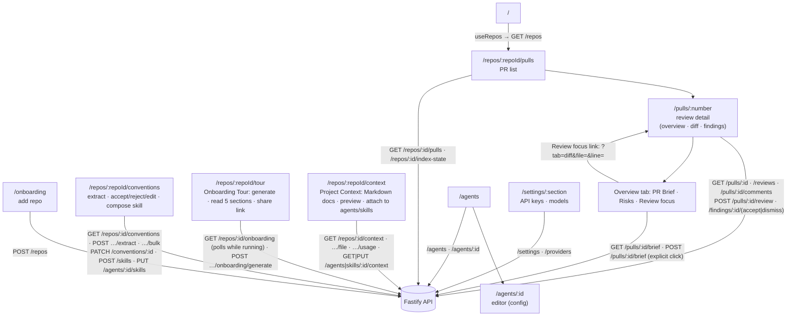

# `@devdigest/web` — the studio (Next.js 15)

The DevDigest UI: import repos, browse pull requests, run and read AI reviews,
and author agents. App Router + React Server/Client components, data via
**TanStack Query** hooks over the Fastify API. (This is the starter surface;
course lessons add the Skills, Memory, Eval, Blast/Brief, multi-agent, CI, and
dashboard screens.)

- **Stack:** Next.js 15 (App Router), React 19, TanStack Query, `next-intl`
  (messages in `messages/<locale>/*.json`), `recharts`, `mermaid`,
  `react-markdown`. UI primitives are vendored under `src/vendor/ui`
  (`@devdigest/ui`) and shared Zod contracts under `src/vendor/shared`
  (`@devdigest/shared`).
- **API base:** `NEXT_PUBLIC_API_BASE` (default `http://localhost:3001`), used by
  `src/lib/api.ts`. Every data hook lives in `src/lib/hooks/*`.
- **Run:** `pnpm dev` (`:3000`). **Test:** `pnpm test` (vitest + jsdom, fetch
  mocked — no API needed). **Typecheck:** `pnpm typecheck`.

## UI route map

Routes (`src/app/**/page.tsx`) and the API surface each leans on (via
`src/lib/hooks/*` → `src/lib/api.ts`):

Cross-cutting chrome lives in `src/components/app-shell` (nav, breadcrumbs,
`g`-then-key shortcuts). Pages are thin; feature logic sits in colocated
`_components/<Name>/` folders, each with its own `*.test.tsx`.

### PR Brief on the Overview tab

The Overview tab of `/repos/:repoId/pulls/:number` shows three brief blocks, all
fed by `usePrBrief` / `useGenerateBrief` in `src/lib/hooks/brief.ts`
(`src/app/repos/[repoId]/pulls/[number]/_components/`):

- **`BriefCard`** — the summary, an "outdated" badge when the API reports `stale`,
  and lines for missing inputs and an outdated intent. Opening the tab only reads
  the stored brief; generating is always an explicit click (Generate / Refresh).
  On a 409 `brief_in_progress` the card re-reads the brief every 5 s, for at most
  100 s, until `generated_at` changes. The POST has no client timeout because the
  LLM call can run long.
- **`BriefRisks`** — the risks as a list: severity icon, title, first file ref.
  It is not grouped by file.
- **`ReviewFocus`** — a numbered list of `file:line — reason` links. A link goes to
  `<pathname>?tab=diff&file=<path>&line=<n>` via `router.replace`.

`DiffTab` reads `file` from the URL and matches it exactly against the PR files
(`matchTarget` in `DiffTab/helpers.ts`). The matching `FileCard` expands, scrolls
into view, and takes focus (`FileCard.tsx`). If the path is not in the diff, a
status line says so. The `line` parameter is part of the link but the client does
not read it yet, so the jump lands on the file, not the line.

## Testing

Component/interaction tests (`*.test.tsx`) run under vitest + jsdom with `fetch`
mocked, so they need neither the API nor a browser. The real browser journeys
(client + API + seeded DB) are covered by the deterministic agent-browser suite
in [`../e2e`](../e2e/README.md) and the `e2e-web.yml` workflow. See
[`../TESTING.md`](../TESTING.md).
