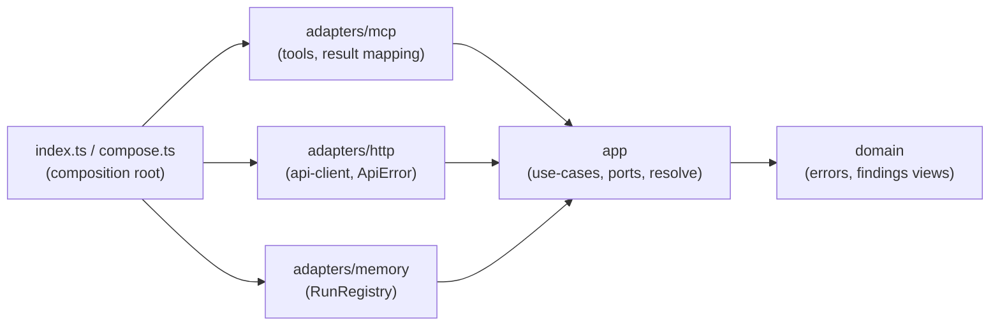

# mcp — @devdigest/mcp

DevDigest MCP server (stdio). It lets an MCP client (Claude Code, etc.) list review agents, run an
agent on a PR, and read findings and conventions. It reaches DevDigest **only through the HTTP API**
on `:3001` — no DB, no direct imports from `server/` except the type/zod contracts.

## Architecture (rings)

Imports point inward: `domain ← app ← adapters ← compose/index`.



Rules (enforced by `npm run arch:check`, 6 dependency-cruiser rules, no baseline):

1. `domain-is-pure` — domain imports nothing from app, adapters, compose, index, the MCP SDK or zod.
2. `core-contracts-type-only` — domain/app use `@devdigest/shared` as `import type` only.
3. `app-no-infra` — app imports nothing from adapters, compose, index, the SDK or zod.
4. `sdk-only-at-mcp-edge` — only `adapters/mcp`, `compose.ts`, `index.ts` import `@modelcontextprotocol/*`.
5. `adapters-isolated` and `mcp-adapter-isolated` (rule 5, split in two) — `adapters/http` and
   `adapters/memory` import no other adapter folder; `adapters/mcp` may import only
   `adapters/http/errors.ts`; no adapter imports compose/index.

## Tools

| Tool | Args | Output |
|------|------|--------|
| `list_agents` | — | enabled agents (id, name, model) |
| `run_agent_on_pr` | `repo` (`owner/name`), `pr`, `agent` (id or name), `timeout_s?` (5–600, default 300), `severity_min?`, `detail?` (`concise`\|`full`) | findings + verdict when done; on timeout `{status:"running", run_id, hint}` |
| `get_findings` | `run_id?`, `repo?`, `pr?`, `agent?`, `severity_min?`, `detail?` | one run, or all runs of a PR |
| `get_conventions` | `repo`, `category?` | accepted conventions (capped, with `truncated`/`hint`) |
| `get_blast_radius` | `repo`, `pr` | the PR's blast radius (same body as `GET /pulls/:id/blast-radius`, plus `repo`/`pr`): changed symbols, callers as `file:line`, endpoints/crons, `stats`, `degraded`/`degraded_reason`; adds `hint` when degraded and `truncated_callers` when capped |

Start budget (measured): `tools/list` + `instructions` = 3 140 chars (about 785 tokens) against a
1 500-token budget.

### Endpoint mapping

| Port method | API call |
|-------------|----------|
| `listAgents` | `GET /agents` |
| `listRepos` | `GET /repos` |
| `listPulls` | `GET /repos/:id/pulls` |
| `startReview` | `POST /pulls/:id/review` (10/min rate limit) |
| `listRuns` | `GET /pulls/:id/runs` |
| `listReviews` | `GET /pulls/:id/reviews` |
| `listConventions` | `GET /repos/:id/conventions` |

### Errors

Tool failures are returned as `isError` results with an actionable text (`adapters/mcp/result.ts`):

- Domain errors: their own message (e.g. `repo "x" not found; known repos: …`, `agent "x" not found; call list_agents …`).
- `ZodError` (bad args): `invalid arguments (<path>: <message>; …); check the tool's input schema`.
- API unreachable: `DevDigest API is not responding at <url>; start it with ./scripts/dev.sh`.
- 429: `rate limit hit (POST /pulls/:id/review allows 10/min); retry in a minute`.
- 404: `DevDigest API returned 404 for <url>; check repo, PR and run ids`.
- Other HTTP: `DevDigest API error <status>: <message>`.
- Anything else: a generic message; details go to stderr.

## Configuration

- `DEVDIGEST_API_URL` — API base URL, default `http://localhost:3001`.
- Registration for Claude Code: `.mcp.json` at the repo root (`mcpServers.devdigest`, stdio via `tsx`).
- stdout carries protocol frames only; logs go to stderr.

## Limitations

- **Client tool timeout.** `run_agent_on_pr` blocks while polling (up to `timeout_s`). Many clients
  enforce their own tool timeout; if it is shorter, lower `timeout_s` or call `get_findings` later.
  On timeout or client abort the tool returns `status: running` with a `run_id`.
- **`run_id` lookups.** No API endpoint maps a run id to a PR. `get_findings(run_id)` resolves it
  through the in-process `RunRegistry` (runs started by this MCP process), or you pass `run_id` plus
  `repo` plus `pr`. Otherwise: `run_id not started in this MCP session; pass repo and pr too`.
- `registerTool` is called through a loose registrar cast in `adapters/mcp/register.ts` because the
  SDK's generic over `ZodRawShape` hits TS2589 (type instantiation too deep).

## Commands

```sh
cd mcp
npm run typecheck
npm run arch:check
npm test
npm start          # stdio server (normally launched by the client)
```

npm, not pnpm. `@devdigest/shared` resolves to `../server/src/vendor/shared`; `zod` is aliased to this
package's `node_modules`.

## Manual live smoke

1. `./scripts/dev.sh` (Postgres, migrate, seed, API on :3001).
2. Open Claude Code in the repo root and approve the `devdigest` server from `.mcp.json`.
3. Call `list_agents`, then `run_agent_on_pr` on the seeded PR `#482`.
