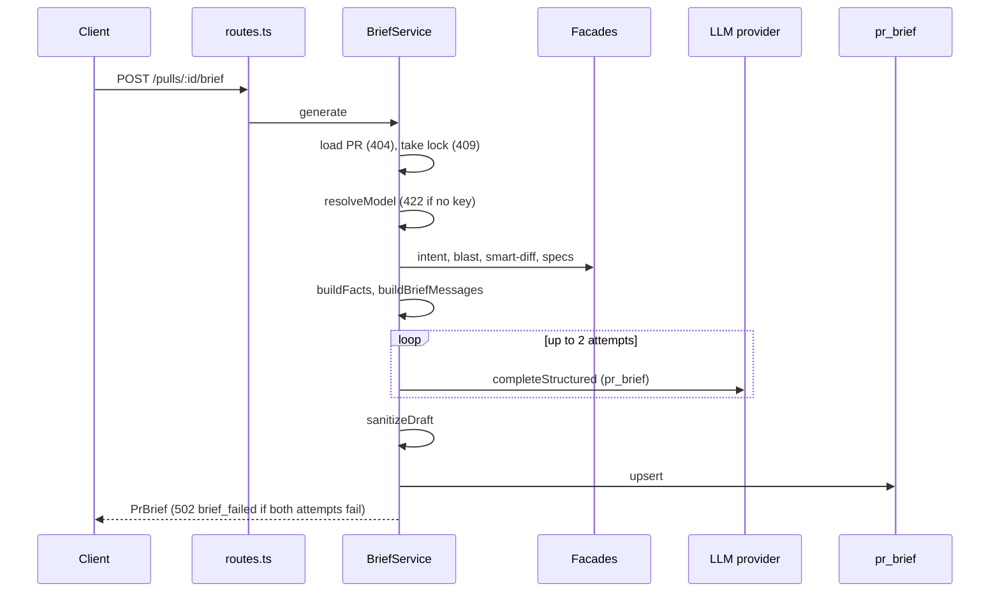

# PR Risk Brief (`modules/brief`)

The PR Risk Brief is a short, stored summary of one pull request: why it exists, which risks it carries, and where a reviewer should start reading. This page explains the generation flow, the limits, and the trust boundary. The routes are listed in the [API map](../README.md).

## Layers

Dependencies point inward: `routes` → `compose` → `service` → `ports` ← `repository`.

| File | Role |
|------|------|
| `routes.ts` | `GET` and `POST /pulls/:id/brief`; maps errors with `http-errors.ts` |
| `compose.ts` | The only place that wires the module to the container; resolves the `risk_brief` feature model |
| `service.ts` | `BriefService`: lock, fact gathering, LLM attempts, store |
| `facts.ts` | `buildFacts`: turns sibling-module data into prompt facts |
| `prompt.ts` | `BriefDraft` schema, system prompt, `<untrusted>` rendering, token fitting |
| `validate.ts` | `sanitizeDraft` and `parseStoredBrief` |
| `helpers.ts` | Hunk-range parsing, code-point truncation |
| `constants.ts` | All limits |
| `repository.ts` | Upserts `pr_brief.json` |

The module reads other features only through their facades (`container.intent`, `container.blast`, `container.smartDiff`, `container.runContext`). It never derives an intent, runs a review, or computes blast radius itself.

## Generation flow

`GET` returns the stored brief and a `stale` flag (`head_sha` differs from the PR head). It never calls the LLM. Only `POST` generates.

Source: `src/modules/brief/service.ts`, `routes.ts`, `compose.ts`.

1. The service loads the PR in the workspace. An unknown PR is 404 `pr_not_found`.
2. It takes an in-memory lock per PR id. A second concurrent `POST` gets 409 `brief_in_progress`. The lock lives in the service instance, so it works for one API process only.
3. It resolves the model and provider first, so a missing key fails with 422 `llm_not_configured` before any fact gathering.
4. It reads intent, blast radius, Smart Diff facts and project-context specs in parallel. A failure in the specs read is logged and treated as "no specs".
5. `buildFacts` records which inputs are missing (`intent`, `blast`, `specs`, `review_findings`) and whether the intent is stale. The brief stores this as `missing_inputs` and `intent_stale`, and the prompt asks the model to name them in the summary.
6. The LLM call uses `temperature: 0`, 45 s per attempt, at most 2 attempts. Only the call and the draft parse are retried. `cost_usd` is the sum over all attempts, including an attempt whose draft was invalid; it is `null` when no cost was reported. Two failed attempts give 502 `brief_failed`.
7. `sanitizeDraft` runs once, then the brief is upserted into `pr_brief` (one row per PR, `json` column).

The stored `history` is always empty: PR history is not produced yet. A stored JSON that no longer parses as `PrBrief` is treated as absent (`parseStoredBrief`).

## Limits

| Limit | Value | Applies to |
|-------|-------|-----------|
| `MAX_FILES` / `MAX_RANGES_PER_FILE` | 100 / 20 | Files and hunk ranges shown in the prompt |
| `MAX_ANCHORS` | 30 | Review findings shown, most severe first |
| `MAX_BLAST_SYMBOLS` / `MAX_BLAST_CALLERS` | 30 / 50 | Blast data shown in the prompt |
| `MAX_DESCRIPTION_CHARS` | 4000 | PR title and description, each |
| `MAX_PROMPT_TOKENS` | 20,000 | Whole prompt |
| `MAX_RISKS` / `MAX_FOCUS` | 6 / 6 | Output items |
| `MAX_SUMMARY` / `MAX_RISK_TITLE` / `MAX_EXPLANATION` / `MAX_REASON` / `MAX_KIND` | 600 / 120 / 500 / 200 / 40 | Output code points |

Source: `src/modules/brief/constants.ts`. When the prompt is over budget, `buildBriefMessages` first drops blast symbols and callers, then files from the end (`prompt.ts`). Spec size is bounded by `resolveForRepo`, not here.

## Trust boundary

The model never sees diff text. It sees facts: file paths, roles, line counts, and the numbers from `@@` hunk headers (`helpers.ts` `hunkRanges`).

- **Input.** Every value that comes from GitHub, the repo, or an earlier LLM call — PR title and description, intent, blast radius, changed files, review findings — sits in its own `<untrusted>` block via `wrapUntrusted`. Specs use `wrapSpec` from reviewer-core. The system prompt says such blocks are data, and a reminder repeats this after the data (`prompt.ts`).
- **Output.** The draft is untrusted too. `sanitizeDraft` (`validate.ts`) checks it against the PR itself:
  - A risk keeps only `file_refs` whose path is a changed file or a caller file from the blast radius; a risk with no valid ref is dropped.
  - A review-focus item is dropped unless its file is changed and its line lies in one of that file's new-side hunk ranges. The check uses all hunks of the PR, not only the ranges the prompt had room for.
  - Items are cut to 6 in model order, text is truncated by code point, and lone surrogates are replaced (Postgres `jsonb` rejects them).
- **Schema.** `BriefDraft` is strict on every object, so extra keys fail the parse and count as a failed attempt.

## Known limitations

- The client has no server-side "generating" flag. After a 409 it polls `GET` and compares `generated_at` (see the [client README](../../client/README.md)). A generation that outlives the poll window looks like nothing happened until the page is reloaded.
- The lock is per process and in memory.
- `history` is always `{ history: [] }`.
