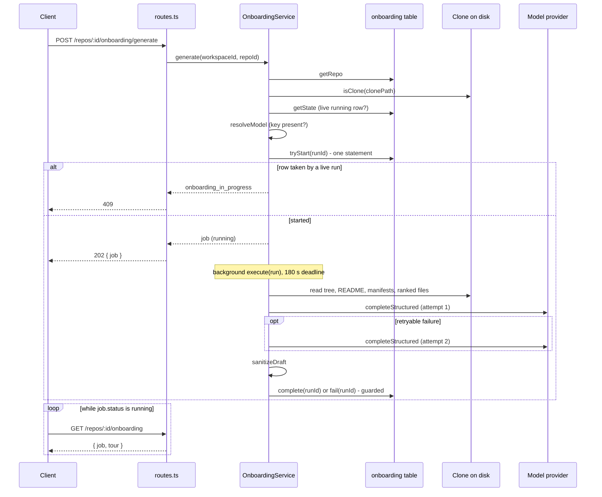

# Onboarding Tour (`modules/onboarding`)

The Onboarding Tour turns a cloned repo into a five-section guide for a new contributor: an architecture summary with a diagram, critical paths, run steps, a reading path and first tasks. One LLM call writes it. This page explains the layers, how a generation runs and how it is protected, what goes into the model, and how the answer is cleaned before it is stored.

## Layers

Dependencies point inward: `routes` → `compose` → `service` → `ports` ← `repository` / `fs-source`.

| File | Role |
|------|------|
| `routes.ts` | `GET /repos/:id/onboarding`, `POST /repos/:id/onboarding/generate`; maps domain errors with `http-errors.ts` |
| `compose.ts` | Builds `container.onboarding(logger)`: model resolution, provider factory, prompt loader |
| `service.ts` | `OnboardingService`: `get`, `generate`, background `execute`, deadline, retry |
| `domain.ts` | `OnboardingDomainError`, `GenerationAbort`, `isStaleRunning`, `isSafeRelativePath` (pure) |
| `ports.ts` | `OnboardingStore`, `RepoFiles`, `IndexSource`, `HeadReader`, `TokenCounter` |
| `repository.ts` | `OnboardingRepository`: the `onboarding` table (one row per repo) |
| `fs-source.ts` | `FsRepoFiles`: reads the clone's working tree |
| `input.ts` | Secret filter, index status mapping, token-budget trimming |
| `prompt.ts` | `OnboardingTourDraft` (model output schema) and `buildMessages` |
| `validate.ts` | `sanitizeDraft`: cleans the model's answer |
| `classify.ts` | Maps an error to one fixed text; decides what is retryable |
| `constants.ts` | Limits and the fixed error texts |

The system prompt is `src/prompts/onboarding.system.md`. The model and provider come from the workspace's feature-model setting `onboarding`; without an override the registry default applies (`openrouter`, `deepseek/deepseek-v4-flash`).

## API

| Route | Success | Errors |
|-------|---------|--------|
| `GET /repos/:id/onboarding` | `200 { job, tour }`; both `null` before the first run | `404` unknown repo |
| `POST /repos/:id/onboarding/generate` | `202 { job }` | `404` unknown repo · `409 repo_not_cloned` · `409 onboarding_in_progress` · `422 llm_not_configured` |

`GET` never calls the provider. A bad `:id` fails with `422` like on every route (zod validation handler).

The contract is `OnboardingTourResponse` and `OnboardingGenerateResponse` in `src/vendor/shared/contracts/knowledge.ts`. The Onboarding block is identical in the client copy (`client/src/vendor/shared/contracts/knowledge.ts`). Other parts of those two files differ today; that is not specific to this feature.

## How a generation runs

The `POST` answers fast and the work happens in the background. The client polls `GET` every 2 seconds while `job.status` is `running` (`client/src/lib/hooks/onboarding.ts`).

The question this diagram answers: what happens between the click and the stored tour?

Source: `src/modules/onboarding/routes.ts`, `service.ts:generate`, `service.ts:execute`, `repository.ts`, `client/src/lib/hooks/onboarding.ts`.

`generate` checks in this order, and the first failure ends the request before any row is written:

1. The repo exists in the workspace (`404`).
2. The repo has a `clonePath` and `isClone` is true: a directory with a `.git` entry (`409 repo_not_cloned`).
3. No live `running` row exists (`409 onboarding_in_progress`).
4. The model resolves and its key is present (`422 llm_not_configured`). `compose.ts` builds a provider once as a probe so a missing key fails here and not in the background.
5. `tryStart` wins the row (`409 onboarding_in_progress` if another request got it first).

### Run identity: `tryStart` and compare-and-set

Each run gets a new `runId` (a UUID). The table has one row per repo (`repo_id` is the primary key), so a new run replaces the previous result row.

- `tryStart` is a single `INSERT … ON CONFLICT DO UPDATE … WHERE`. The update only applies when the existing row is not `running`, or its `started_at` is older than `STALE_RUN_MS` (10 minutes). If a live run holds the row, the statement returns nothing and the service answers `409`. Two parallel `POST`s therefore cannot both start.
- `complete` and `fail` update only when the `run_id` matches, the status is still `running`, and `started_at` is not older than the stale threshold. If the guard fails, the result is dropped and the service logs `result discarded (run replaced or stale)`. A slow run can never overwrite a newer one.
- A `running` row older than 10 minutes is a crashed run. `toJobDto` reports it as `failed` with `Generation did not finish (the server stopped mid-run)`, and the next `POST` may take it over. Nothing reaps it on boot.

Source: `repository.ts` (`tryStart`, `liveRun`), `helpers.ts`, `domain.ts:isStaleRunning`, `constants.ts`.

### Deadline and request budget

- The wall-clock budget is `DEADLINE_MS` = 180 s, counted from the `started_at` of the `running` row. It covers input assembly, the model call and cleaning.
- `withDeadline` stops waiting when the budget ends and fails the run with the deadline text. It sets `run.expired`, so work that is still running cannot start another provider request.
- A generation sends at most `MAX_HTTP_REQUESTS` = 2 requests to the provider: one call plus one retry. The providers are built with `maxRetries: 0`, so the service owns the only retry loop and the count is kept in one place (`compose.ts`, `service.ts:callModel`). Each request gets `timeoutMs` equal to the time left.
- The retry happens only for a schema failure, a network error, HTTP `429` or HTTP `5xx`. A timeout or a deadline abort is never retried (`classify.ts:isRetryable`).

Current behaviour, not a bug: the service does not pass an `AbortSignal` to the provider. After the deadline an in-flight request keeps running until its own `timeoutMs` ends, but its result is discarded and no new request starts.

## What the model sees

`gatherInput` (`service.ts`) reads the clone and builds the input. The limits live in `constants.ts`.

| Part | Rule |
|------|------|
| File tree | Up to 500 paths, sorted. Skips `node_modules`, `dist`, `build`, `coverage`, `.next`, `out`, `vendor`, `.git`. Symlinks are skipped |
| README | One root file whose name starts with `readme` (case-insensitive). `README.md` wins, then the shortest name, then alphabetical. Up to 20,000 chars |
| Manifests | Root files by exact name: `package.json`, `docker-compose.yml`, `docker-compose.yaml`, `compose.yml`, `Makefile`, `Dockerfile`, `.env.example`. Each up to 400 lines and 20,000 chars |
| Lock files | Names only (`pnpm-lock.yaml`, `package-lock.json`, `yarn.lock`), never their content |
| Ranked files | Only when the index status is `full` or `partial`: the top 15 files by rank, each up to 200 lines and 20,000 chars. Files already read are skipped |
| Call chains | Only with ranked input: the critical paths from repo-intel |

The index status is `none` (and `files_indexed` 0) when `REPO_INTEL_ENABLED` is off or repo-intel has no data. Otherwise it is the repo-intel status (`full`, `partial`, `degraded`, `failed`). `degraded` and `failed` get no ranked files and no chains.

### Secrets and symlinks

- `isSecretPath` blocks `.env`, `.env.*`, and files ending in `.pem` or `.key`. `.env.example` is allowed. A secret path is removed from the tree, the README choice, the ranked files and the call chains. It is also refused later when the model cites it.
- `FsRepoFiles` never enters a symlinked directory and never lists a symlinked file. `readCapped` returns `null` when the real path differs from the lexical path, so a harmless name that points at a secret cannot expose it. `isRegularFileInside` accepts only a regular file whose real path stays inside the clone.
- Containment uses `rel === '..' || rel.startsWith('..' + sep) || isAbsolute(rel)`, so a root file named `..notes.md` is not treated as outside (see `server/INSIGHTS.md`).

### Prompt shape and token budget

`buildMessages` puts the system prompt in the `system` message. All repo content goes into the `user` message, each part wrapped with `wrapUntrusted` (the file tree, the lock file names, every file with a `kind:path` label, and the call chains). The path is only inside the block's `source` label, with `"`, `<`, `>` and line breaks replaced by `_`.

`fitToBudget` counts tokens with `container.tokenizer` (cl100k) against `MAX_INPUT_TOKENS` = 60,000. If the input is too big, it trims in this order and stops as soon as it fits:

1. Ranked files, lowest rank first.
2. Call chains, last first.
3. The file tree, to the longest prefix that fits.

The README and manifests are never trimmed. If it still does not fit, the run fails with the context-too-large text.

## Cleaning the answer

The model returns `OnboardingTourDraft` (`prompt.ts`). `sanitizeDraft` (`validate.ts`) turns it into the stored shape in a fixed order: drop invalid items, cut texts, remove duplicates, apply the count caps.

- A cited path is kept only if it is a safe relative path (no absolute, `..`, backslash, NUL or empty segment), not secret, and a regular file inside the clone.
- Diagram nodes get ids `n1`… in order; a node with an invalid path keeps its place but gets `path: null`. Edges that point at unknown keys are dropped.
- Node labels are limited to `A-Z a-z 0-9 space . _ / * @ : -` (anything else becomes `_`) and cut to 40 chars.
- Run steps must cite a `source_path` the model actually saw (README, manifest or ranked file), and the command must be at most 500 chars.
- First tasks with no valid file are dropped.
- Texts are cut with a trailing `…` and never split a surrogate pair (Postgres `jsonb` rejects a lone surrogate).
- Caps: 12 nodes, 20 edges, 8 critical paths, 10 run steps, 8 reading-path items, 5 first tasks with up to 3 files each.

After cleaning, `execute` adds `commit_sha` (HEAD at the start), `files_indexed` and `index_status`, stamps `generated_at` with the same timestamp as the job's `finished_at`, and validates the result with the `OnboardingTour` contract before `complete`. On read, `getState` parses the stored JSON with the same contract; a stored tour that no longer matches is returned as `tour: null` and logged.

## Errors

Only these fixed texts reach `job.error`. The raw provider text is logged once and never stored or returned (`classify.ts`, `constants.ts`).

| Text | When |
|------|------|
| `The model did not respond within 180 s` | Deadline hit, or a timeout error without an HTTP status |
| `The model returned a tour that doesn't match the expected format` | Provider reported a schema validation failure (after the retry) |
| `The model provider returned an error (HTTP <status>)` | The error carries an HTTP status |
| `Couldn't reach the model provider` | Connection error (`ECONNRESET`, `ENOTFOUND`, …) |
| `Repository context is too large for the model (over 60,000 tokens)` | Trimming could not fit the budget |
| `Generation did not finish (the server stopped mid-run)` | A `running` row older than 10 minutes, shown as `failed` |
| `Generation failed unexpectedly` | Anything else |

## Known behaviour to be aware of

- A failed run keeps no tour, but the row of an earlier successful run is replaced by the new `running` row at `tryStart`; the stored `json` stays in the table until `complete` overwrites it, so `GET` can return the old `tour` next to a `failed` job.
- If a repo has no clone, the last job failed and there is no tour, the studio shows the not-cloned state (plan AC36 edge, accepted).
- There is no `AbortSignal` for an in-flight provider request (see Deadline and request budget; plan Risks).

## Tests

Unit tests are in `server/test/onboarding-*.test.ts`; the DB-backed flow is `server/test/onboarding.it.test.ts`. Commands: see [`../README.md`](../README.md) §Testing.
