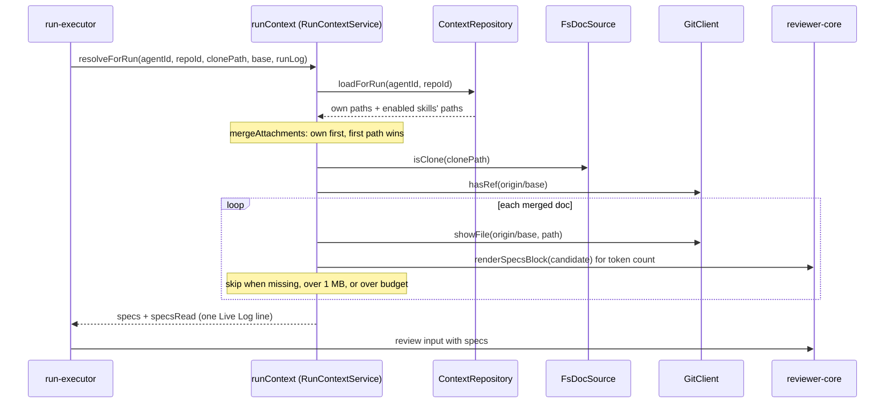

# Project Context (`modules/context`)

Project Context lets you attach Markdown docs from a cloned repo (specs, INSIGHTS, READMEs) to an agent or a skill. Every review run of that agent then reads the docs and adds them to the prompt. This page explains the module layout, the path and size rules, the errors, and the run path.

## Layers

Dependencies point inward: `routes` → `compose` → `service` → `ports` ← `repository` / `fs-scanner`.

| File | Role |
|------|------|
| `routes.ts` | Fastify routes; maps domain errors with `http-errors.ts` |
| `compose.ts` | Builds `container.projectContext` and `container.runContext` |
| `service.ts` | `ContextService`: list/read docs, usage, get/set attachments |
| `run-context.service.ts` | `RunContextService`: resolves the docs for one run |
| `domain.ts` | `mergeAttachments` and `ContextDomainError` (pure) |
| `paths.ts` | Path rules, `categoryOf`, `folderOf` (pure) |
| `ports.ts` | `DocSource`, `AttachmentStore`, `BaseRefReader`, `TokenCounter` |
| `fs-scanner.ts` | `FsDocSource`: reads the clone's working tree |
| `repository.ts` | `ContextRepository`: the `context_attachments` table |
| `constants.ts` | Limits |

Why two services: the UI reads the **working tree** (`FsDocSource`), but a run reads **`origin/<base>`** through git, so a PR that edits a doc cannot change the context its own review sees.

## Routes

| Route | Purpose |
|-------|---------|
| `GET /repos/:id/context` | List docs (`SpecFileList`: `docs`, `truncated`) |
| `GET /repos/:id/context/file?path=` | One doc with `content` |
| `GET /repos/:id/context/usage?path=` | Agents and skills that attach the doc |
| `GET\|PUT /agents/:id/context?repo_id=` | Own and inherited attachments of an agent |
| `GET\|PUT /skills/:id/context?repo_id=` | Attachments of a skill (`inherited` is always `[]`) |

`PUT` replaces the whole set for that owner and repo. Attachments live in `context_attachments` (`src/db/schema/context.ts`).

## Path rules

`validateDocPath` (`paths.ts`) rejects a client path when it:

- is empty, contains `\0`, or is absolute (`/`, `\`, or a drive letter);
- contains a `..` segment (traversal);
- is non-canonical: a `.` or empty segment (`a//b.md`, `./a.md`);
- does not end in `.md` or `.mdx` (case-insensitive);
- has a directory segment that is excluded.

Excluded directories: `node_modules`, `.git`, `dist`, `build`, `vendor`, and every other dot-directory except `.devdigest`. The scanner uses the same `isExcludedDir` check.

Symlinks (`fs-scanner.ts`):

- The scanner never enters a symlinked directory.
- A symlinked doc file is listed only if its real path stays inside the clone and is a regular file; a dangling link is skipped.
- `read` refuses a path whose real path leaves the clone (`outside`) and treats a symlinked intermediate directory as missing (or `outside` when it points out of the clone).

## Limits

Defined in `constants.ts`.

| Limit | Value | Effect |
|-------|-------|--------|
| `MAX_DOC_BYTES` | 1 MB (1,048,576) | Larger docs get `status: 'too_large'` and `tokens: null`; a run skips them |
| `MAX_DOCS` | 500 | The list is cut and `truncated: true` is returned |
| `MAX_ATTACHMENTS` | 50 | More than 50 paths in a `PUT` is rejected |
| `CONTEXT_TOKEN_BUDGET` | 8,000 tokens | Per run, see below |

## Errors

| Status | Code | When |
|--------|------|------|
| 404 | `not_found` | Unknown repo, agent, skill, or doc |
| 409 | `repo_not_cloned` | The repo has no usable clone (also when the clone root is unreadable) |
| 422 | `validation_error` | A path breaks the rules above, a duplicate path in `PUT`, more than 50 paths, or a path that resolves outside the clone |

The domain code is `invalid_path`, but `http-errors.ts` maps it to `ValidationError`, so the envelope code is `validation_error`. Only `repo_not_cloned` keeps its own code. A body with more than 50 paths, or a non-uuid `:id` or `repo_id`, fails zod validation and gets the same 422.

## Run path

How do attached docs reach the prompt of one agent run?

Source: `server/src/modules/reviews/run-executor.ts:228-247`, `server/src/modules/context/run-context.service.ts:30-72`, `server/src/modules/context/domain.ts:23`.

Steps:

1. **Merge.** `mergeAttachments` puts the agent's own docs first, then the docs of each enabled skill (enabled link and enabled skill, in the agent's order). The first occurrence of a path wins.
2. **Check the source.** No clone, or no `origin/<base>` ref, skips everything. There is no fetch: `hasRef` only checks the local ref.
3. **Read from git.** Each doc comes from `showFile(origin/<base>, path)`, never from the PR head or the working tree. A missing or over-1 MB doc is skipped.
4. **Budget.** A doc is added only if the whole block, measured with `renderSpecsBlock`, stays within 8,000 tokens. A doc that does not fit is skipped and later, smaller docs can still fit.
5. **Wrap.** `renderSpecsBlock` wraps each doc as `<untrusted source="spec:<path>">…</untrusted>` (`reviewer-core/src/prompt.ts`), so `INJECTION_GUARD` treats it as data.
6. **Log.** The service writes `Project context: N doc(s), +T tokens — <paths>`; skips write `Project context: skipped <path> (missing|budget)`, or a whole-run skip line (`none attached`, `repo not cloned`, `base branch … not fetched`).

If `resolveForRun` throws, `run-executor` logs `Project context: skipped (error: …)` at **info** level and continues with no docs. It uses `info` because an `error` log line becomes an SSE `error` event and the client would show an agent-failure toast for a run that succeeded (`server/INSIGHTS.md`, 2026-10-24).

The trace records the paths as `specs_read` (`run-executor.ts:349`).
